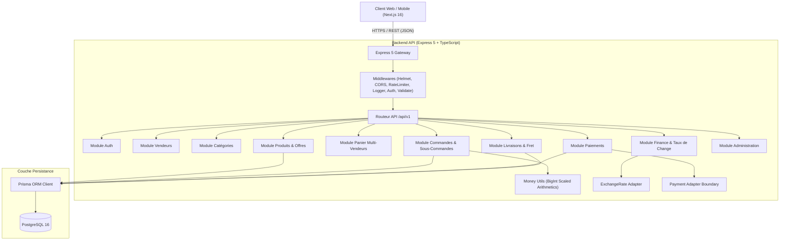

# 🏛️ AgroConnect — Architecture Technique & Conception Système

## 1. Vue d'Ensemble de l'Architecture

AgroConnect adopte une architecture modulaire découplée articulée autour d'un backend Node.js / Express en couches orientées domaine et d'une application frontend Next.js moderne (App Router).

---

## 2. Découpage Modulaire du Backend

Le backend est structuré selon les principes du Domain-Driven Design (DDD) allégé :

### Répertoires principaux (`backend/src/`) :
- **`config/`** :
  - `env.ts` : Validation stricte des variables d'environnement via des schémas **Zod**.
  - `drc.ts` : Spécifications géographiques congolaises (26 provinces, villes principales, opérateurs Mobile Money).
- **`common/`** :
  - `money.ts` : Moteur de calculs financiers de haute précision utilisant `BigInt` (échelle $100$ pour centièmes/centimes) sans flottants JS.
  - `errors.ts` : Hiérarchie d'exceptions standardisées (`AppError`, `ValidationError`, `BusinessRuleError`, `NotFoundError`).
  - `response.ts` : Formateur d'enveloppe de réponses JSON `{ success, data, error, meta }`.
  - `security.ts` : Hachage de mot de passe `scrypt` et signature de jetons d'authentification HMAC-SHA256 en temps constant.
  - `middleware/` : Middlewares réutilisables (authentification RBAC, validation Zod, limitation de débit, journalisation).
- **`database/`** :
  - `client.ts` : Gestionnaire de cycle de vie de connexion de données.
  - `schema.prisma` : Modèle de données complet avec index, contraintes relationnelles et types énumérés.
- **`integrations/`** :
  - Frontières d'intégration isolant la logique métier des SDKs et APIs externes (voir `docs/EXTERNAL_INTEGRATIONS.md`).
- **`modules/`** :
  - 15 domaines fonctionnels indépendants (`auth`, `users`, `sellers`, `categories`, `products`, `offers`, `inventory`, `seller-services`, `cart`, `orders`, `payments`, `deliveries`, `notifications`, `finance`, `admin`).

---

## 3. Précision Financière & Prévention des Flottants

> [!CAUTION]
> En JavaScript, `0.1 + 0.2 === 0.30000000000000004`. Dans une marketplace financière traitant des millions de Francs Congolais et des montants en Dollars Américains, les erreurs d'arrondi binaire sont intolérables.

### Solution AgroConnect (`backend/src/common/money.ts`) :
- Tout montant décimal $X.YY$ est transformé en un entier mis à l'échelle via `BigInt` :
  $$\text{scaled} = \text{Entier} \times 100 + \text{Centimes}$$
- Les additions et soustractions opèrent directement sur les `BigInt`.
- La multiplication par une quantité décimale ou un taux applique un diviseur et un arrondi bancaire équitable (`halfScale`).
- Les commissions ($5\%$) appliquent les points de base sans aucune perte de précision.

---

## 4. Architecture Frontend (Next.js & Tailwind CSS)

L'application frontend tire parti de Next.js (App Router) pour combiner rendu serveur performant et interactivité fluide côté client.

### Directives de conception :
- **Langue :** 100% en Français, vocabulaire agricole adapté au public congolais.
- **Palette de couleurs :**
  - Vert Agricole : `#166534` / `#15803d` (prospérité, fertilité, sérieux).
  - Neutres clairs : `#fcfdfa` / `#ffffff` / `#f5f5f4` (clarté, propreté).
  - Anthracite / Noir : `#1c1917` / `#111827` (lisibilité maximale).
  - Orange agricole retenu : `#ea580c` (actions prioritaires, boutons d'achat, alertes).
- **Contexte Devise (`CurrencyContext`) :**
  - Permet le basculement instantané entre `CDF` et `USD` sur l'ensemble de l'interface sans rechargement de page.
  - Les prix affichent toujours la devise principale choisie avec la conversion secondaire entre parenthèses.
- **Accessibilité & Mobilité :**
  - Optimisé pour écrans mobiles (smartphones très répandus en RDC), tablettes et ordinateurs.
  - Polices systèmes haute lisibilité évitant les blocages réseau vers des serveurs de polices distants.

---

## 5. Sécurité & Qualité

- **En-têtes HTTP sécurisés :** `helmet` activé par défaut.
- **CORS restreint :** Origines configurables par environnement.
- **Contrôle d'accès basé sur les rôles (RBAC) :**
  - Rôles stricts : `BUYER`, `SELLER`, `DELIVERY_PROVIDER`, `DELIVERY_PERSON`, `ADMIN`.
- **Hachage cryptographique :** Algorithme `scrypt` avec sel cryptographique de 16 octets et dérivation en 64 octets.
- **Comparaison en temps constant :** `crypto.timingSafeEqual` prévenant les attaques temporelles par canal auxiliaire.
- **Limitation de débit (Rate Limiting) :** Fenêtre glissante par IP protégeant les points de terminaison sensibles.
