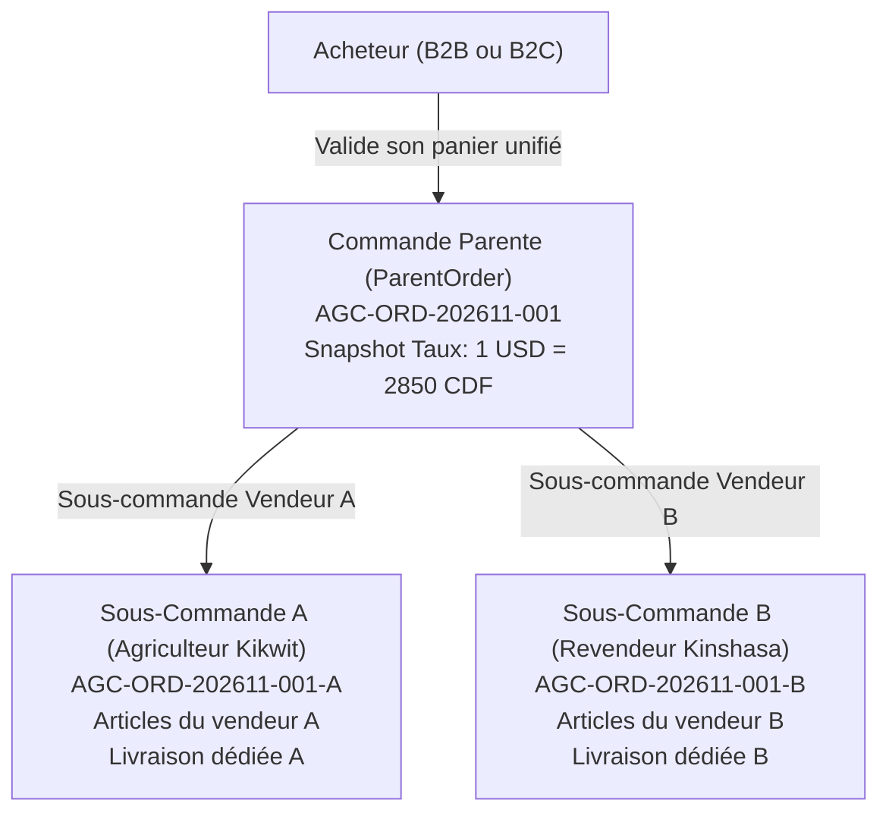

# ⚖️ AgroConnect — Règles Métier & Décisions Fonctionnelles

Ce document consigne l'ensemble des règles métier invariables régissant la plateforme AgroConnect en République Démocratique du Congo.

---

## 1. Règle Fondamentale de Non-Propriété des Stocks

> **Règle BR-001 :** AgroConnect est strictement un intermédiaire de marché (Marketplace).
> AgroConnect n'achète, ne possède, ne stocke ni ne revend aucun produit agricole. Chaque vendeur est légalement et commercialement responsable de son stock physique, de ses prix, de la qualité de ses produits et de l'exécution de ses commandes.

---

## 2. Distinction Catalogue Produit vs Offre Vendeur

> **Règle BR-002 :** Architecture découplée entre Produit Commun et Offre Vendeur.

1. **Produit Catalogue Commun (`Product`) :**
   - Représente l'espèce ou denrée agricole générique (ex : *Manioc Frais Doux*, *Maïs Grain Jaune*, *Haricot Rouge du Kivu*).
   - Contient la nomenclature standardisée, le nom scientifique et la catégorie agronomique.
2. **Offre Vendeur (`Offer`) :**
   - Chaque vendeur publie sa propre offre pour un produit du catalogue.
   - L'offre spécifie : le prix au détail, le prix de gros, le stock disponible, la province d'origine de la récolte, le grade de qualité et les services associés.
   - Plusieurs vendeurs peuvent proposer le même produit sous des conditions commerciales et logistiques différentes.

---

## 3. Gestion Unifiée du Stock Physique (Anti-Survente)

> **Règle BR-003 :** Ventes en gros et au détail partagent obligatoirement le même stock physique.

Pour un vendeur et une offre donnée :
- Il n'y a qu'**un seul stock physique disponible** (`stockQuantity`).
- Qu'un client achète au détail (ex : 2 sacs de 50kg) ou en gros (ex : 20 sacs de 50kg), la quantité commandée est décomptée du même compteur de stock.
- La validation de la commande vérifie toujours que :
  $$\text{Quantité demandée} \le \text{Stock physique disponible}$$
- Cette règle interdit formellement de créer des silos de stocks séparés entre gros et détail pour une même offre.

---

## 4. Politique Monétaire et Snapshot du Taux de Change

> **Règle BR-004 :** Gestion bi-monétaire (CDF / USD) avec immuabilité historique.

1. **Devises autorisées :** Le Franc Congolais (`CDF`) et le Dollar Américain (`USD`).
2. **Taux de change dynamique & configurable :**
   - La logique métier ne présuppose aucun taux fixe codé en dur.
   - Le taux est administrable dynamiquement.
3. **Instantané (Snapshot) immuable lors de la commande :**
   - Dès qu'une commande est créée, le taux de change exact en vigueur ($1\text{ USD} = X\text{ CDF}$) est **enregistré de manière définitive** dans l'enregistrement de la commande (`ParentOrder.exchangeRateSnapshot`).
   - Toute mise à jour ultérieure du taux de change n'affecte en aucun cas les transactions antérieures ni les montants dus aux vendeurs.
4. **Calculs arithmétiques sécurisés :**
   - Interdiction totale de l'arithmétique à virgule flottante (`0.1 + 0.2`).
   - Tous les calculs financiers sont réalisés en entiers à échelle fixe (centimes/centièmes) via `BigInt` avec arrondi standard `ROUND_HALF_UP`.

---

## 5. Panier Multi-Vendeurs & Architecture des Commandes

> **Règle BR-005 :** Un seul panier, une commande parente et $N$ sous-commandes vendeurs.

1. **Commande Parente (`ParentOrder`) :**
   - Vue consolidée pour l'acheteur avec le total général, les frais de livraison globaux et le snapshot du taux de change.
2. **Sous-Commandes Vendeurs (`SubOrder`) :**
   - Chaque sous-commande ne contient que les articles d'un seul vendeur.
   - Un vendeur a accès **strictement et exclusivement à ses propres sous-commandes**. Il ne peut voir ni les articles, ni les marges, ni les coordonnées des autres vendeurs impliqués dans la commande parente.
   - Chaque sous-commande calcule de manière autonome la commission AgroConnect et le montant net à reverser au vendeur (`payoutAmount`).

---

## 6. Vérification Stricte des Paiements Côté Backend

> **Règle BR-006 :** Tolérance zéro sur la confiance du client frontend.

- Le frontend n'a jamais l'autorité pour déclarer une commande payée.
- Toute transaction doit être confirmée par une vérification cryptographique ou un accusé de réception émis par la passerelle de paiement (Mobile Money / Banque) directement validé par le backend.
- Les transactions utilisent des clés d'idempotence (`idempotencyKey`) pour empêcher les doubles débits en cas d'instabilité réseau en RDC.

---

## 7. Cycle de Vie Indépendant de la Livraison

> **Règle BR-007 :** Domaine de livraison découplé avec traçabilité intégrale.

Chaque sous-commande génère un bordereau de livraison (`Delivery`) doté d'un code de suivi unique et de son propre cycle d'états :

| Statut | Signification |
| :--- | :--- |
| `PENDING` | Commande confirmée, en attente de préparation du lot par le vendeur |
| `ASSIGNED` | Transporteur ou livreur affilié assigné à la mission |
| `PICKED_UP` | Lot physique enlevé au champ, au dépôt ou au magasin du vendeur |
| `IN_TRANSIT` | Acheminement en cours (ex : camion sur la RN1, bateau sur le fleuve, moto en ville) |
| `ARRIVED` | Arrivé au centre de distribution ou au point relais de destination |
| `DELIVERED` | Livré et réceptionné par le destinataire (signature ou code OTP) |
| `FAILED` | Échec de livraison (destinataire absent, route coupée, refus) |
| `CANCELLED` | Annulation logistique |

Chaque changement de statut génère une entrée immuable dans `DeliveryStatusHistory` avec horodatage, lieu et notes de transport.

