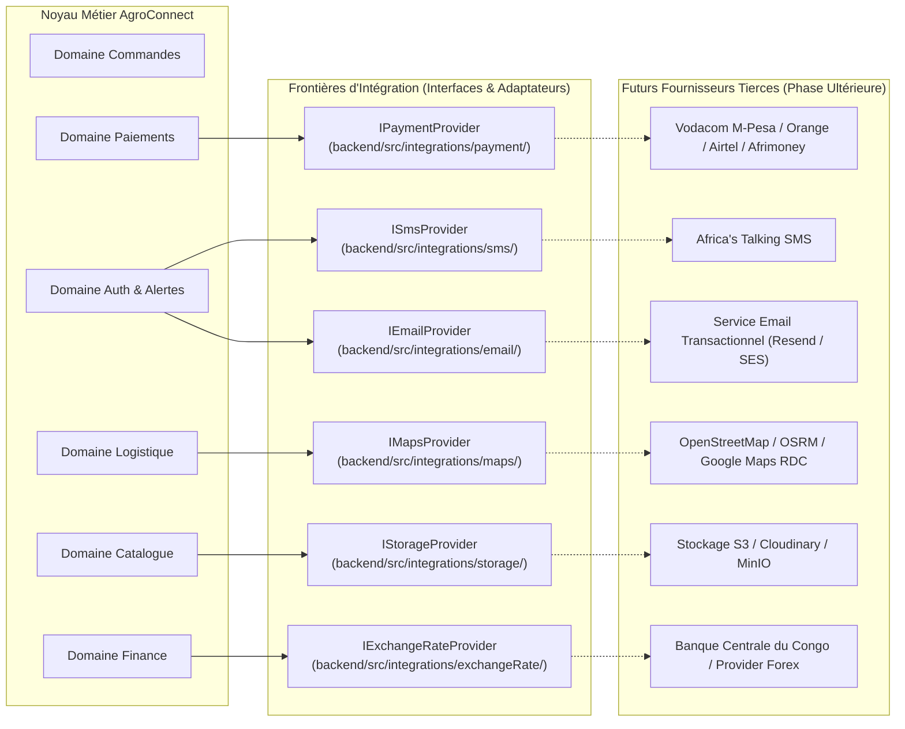

# 🔌 AgroConnect — Frontières d'Intégration Externes

> [!IMPORTANT]
> Conformément aux directives architecturales de la phase d'initialisation, **aucun SDK externe n'est installé**, aucun appel réseau externe n'est effectué et aucun faux identifiant d'API n'est inséré dans le code source.
> L'ensemble des intégrations tierces est matérialisé par des **interfaces TypeScript pures et des adaptateurs autonomes (Mock / In-Memory)** garantissant un fonctionnement 100% opérationnel et autonome.

---

## 1. Cartographie des Frontières d'Intégration

---

## 2. Spécification Détaillée des Interfaces

### A. Passerelle de Paiement Mobile Money (`IPaymentProvider`)
- **Emplacement :** `backend/src/integrations/payment/PaymentProvider.interface.ts`
- **Implémentation initiale :** `MockPaymentProvider.ts`
- **Fournisseurs anticipés pour la RDC :**
  - Vodacom M-Pesa (API C2B et B2C pour reversements)
  - Orange Money RDC
  - Airtel Money RDC
  - Afrimoney (Africell)
- **Méthodes clés :**
  - `initiatePayment(request: PaymentInitiationRequest): Promise<PaymentInitiationResult>`
  - `verifyPayment(transactionId: string): Promise<PaymentVerificationResult>`
  - `refundPayment(transactionId: string, amount: number, reason: string): Promise<{ success: boolean; refundId: string }>`

### B. Passerelle SMS & OTP (`ISmsProvider`)
- **Emplacement :** `backend/src/integrations/sms/SmsProvider.interface.ts`
- **Implémentation initiale :** `MockSmsProvider.ts`
- **Fournisseur anticipé :** Africa's Talking SMS (passerelle panafricaine fiable en RDC).
- **Cas d'usage :**
  - Validation de numéro de téléphone (+243) par code OTP.
  - Notifications par SMS des producteurs ruraux sans connexion Internet permanente (ex: "Votre lot de maïs a été réservé").
- **Méthodes clés :**
  - `sendSms(message: SmsMessage): Promise<SmsSendResult>`
  - `sendOtp(to: string, otpCode: string): Promise<SmsSendResult>`

### C. Service d'Email Transactionnel (`IEmailProvider`)
- **Emplacement :** `backend/src/integrations/email/EmailProvider.interface.ts`
- **Implémentation initiale :** `MockEmailProvider.ts`
- **Cas d'usage :** Factures proforma B2B, bordereaux d'expédition, récapitulatifs comptables.
- **Méthodes clés :**
  - `sendEmail(message: EmailMessage): Promise<EmailSendResult>`

### D. Cartographie, Géolocalisation & Itinéraires (`IMapsProvider`)
- **Emplacement :** `backend/src/integrations/maps/MapsProvider.interface.ts`
- **Implémentation initiale :** `MockMapsProvider.ts`
- **Fournisseurs anticipés :** OpenStreetMap / Nominatim / Mapbox / OSRM adapté aux corridors de transport congolais (RN1, RN2, fleuve Congo).
- **Cas d'usage :**
  - Calcul de distance entre le champ/dépôt et le lieu de livraison.
  - Estimation de la durée et du mode de transport préconisé (Moto, Camionnette, Poids lourd).
- **Méthodes clés :**
  - `calculateDistance(origin: string, destination: string): Promise<RouteEstimate>`
  - `geocode(address: string, province: string): Promise<GeoCoordinates | null>`

### E. Stockage d'Images et Documents (`IStorageProvider`)
- **Emplacement :** `backend/src/integrations/storage/StorageProvider.interface.ts`
- **Implémentation initiale :** `MockStorageProvider.ts`
- **Fournisseurs anticipés :** Compatible S3 (AWS S3, MinIO auto-hébergé ou Cloudinary).
- **Cas d'usage :** Photographies de récoltes, certificats phytosanitaires, pièces d'identité des vendeurs agréés.
- **Méthodes clés :**
  - `uploadFile(options: UploadFileOptions): Promise<UploadFileResult>`
  - `deleteFile(fileId: string): Promise<boolean>`
  - `getPublicUrl(fileId: string): string`

### F. Fournisseur de Taux de Change (`IExchangeRateProvider`)
- **Emplacement :** `backend/src/integrations/exchangeRate/ExchangeRateProvider.interface.ts`
- **Implémentation initiale :** `ConfigExchangeRateProvider.ts`
- **Fonctionnement :**
  - Maintient un taux configurable (par défaut : $1\text{ USD} = 2850\text{ CDF}$).
  - Peut être actualisé par l'administrateur sans redémarrage (`ADMIN_OVERRIDE`).
  - Prépare l'intégration future avec les cours de la Banque Centrale du Congo (BCC) ou des agrégateurs de devises.
- **Méthodes clés :**
  - `getCurrentRate(base: SupportedCurrency, target: SupportedCurrency): Promise<ExchangeRateSnapshot>`
  - `updateRate(rate: number, source?: 'ADMIN_OVERRIDE'): Promise<ExchangeRateSnapshot>`

---

## 3. Règle d'Imperméabilité Métier

La logique métier des modules (`orders`, `payments`, `deliveries`, etc.) dépend **uniquement des interfaces abstraites**. Le remplacement d'un adaptateur de simulation par un adaptateur d'API réelle s'effectuera par simple injection de dépendance sans modifier une seule ligne du code de calcul ou des contrôleurs.
