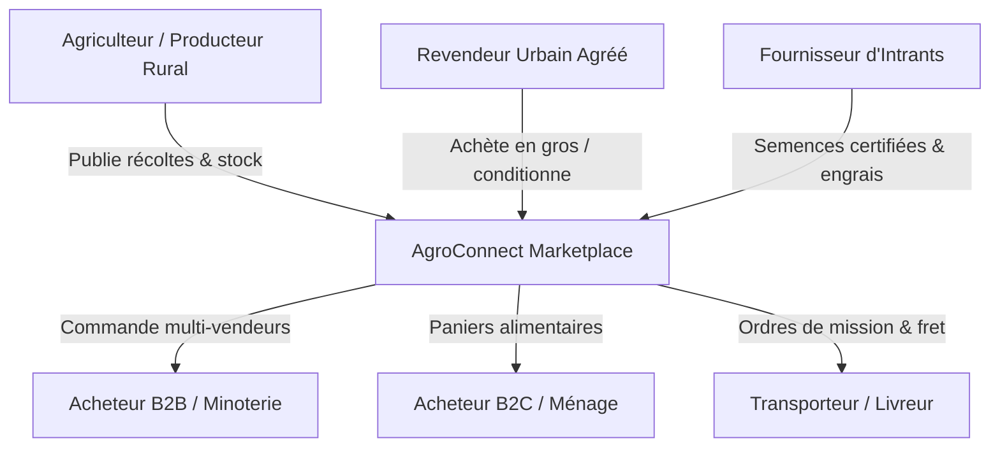

# 🌾 AgroConnect — Aperçu Général du Projet

## 1. Contexte et Problématique en RDC

La République Démocratique du Congo (RDC) dispose de plus de 80 millions d'hectares de terres arables et d'une diversité agro-climatique exceptionnelle. Cependant, le secteur agricole fait face à des défis structurels majeurs :
- **Enclavement et asymétrie d'information :** Les producteurs ruraux (Kwilu, Kongo-Central, Kasaï, Nord-Kivu, etc.) manquent de visibilité sur les prix du marché urbain (Kinshasa, Lubumbashi, Goma).
- **Intermédiation prédatrice :** De multiples courtiers informels réduisent les revenus des paysans tout en augmentant les coûts pour les consommateurs urbains.
- **Pertes post-récolte :** Faute de précommandes et d'acheminement coordonné, une fraction importante de la production pourrit avant d'atteindre les centres de consommation.
- **Accès restreint aux intrants :** Les petits producteurs peinent à se procurer des semences certifiées et des engrais de qualité.

## 2. Mission et Positionnement d'AgroConnect

**AgroConnect** a été créé pour constituer l'infrastructure numérique de référence pour le commerce agricole en RDC.

### Positionnement clé :
- **Périmètre géographique exclusif :** RDC (les 26 provinces).
- **Modèle de place de marché intermédiaire :** AgroConnect ne possède, n'achète, ne stocke ni ne vend aucun produit. La plateforme est le tiers de confiance garantissant la transparence, l'intégrité financière et le suivi logistique.
- **Modèle hybride B2B & B2C :**
  - **B2C :** Les ménages et particuliers achètent au détail des produits frais conditionnés.
  - **B2B :** Les minoteries, transformateurs agro-industriels, restaurants, hôtels et commerçants de marchés achètent en gros directement auprès de coopératives ou grossistes.

## 3. Typologie des Acteurs de la Plateforme

### A. Les Agriculteurs & Producteurs
- Vendent directement leur récolte (manioc, maïs, haricot, légumes).
- Fixent leurs prix de gros et de détail et leurs minima de commande.
- Ont un contrôle total sur leur stock physique.

### B. Les Revendeurs
- Interviennent dans les centres urbains (Kinshasa, Lubumbashi, etc.).
- Achètent des productions, les transportent, les lavent, les calibrent et les conditionnent.
- Proposent des services à forte valeur ajoutée : livraison express, garantie fraîcheur 48h.

### C. Les Fournisseurs d'Intrants et d'Équipements
- Vendent semences améliorées, fertilisants NPK, outillage (houes, pulvérisateurs, motopompes).
- Fournissent des fiches techniques et du conseil agronomique.

### D. Les Acheteurs (B2B & B2C)
- Particuliers : achats alimentaires de qualité au détail.
- Professionnels : grossistes, minoteries, supermarchés, ONG et transformateurs.

### E. Les Transporteurs et Livreurs
- Sociétés de transport routier, fluvial et livreurs urbains (motos / camionnettes).
- Prise en charge des expéditions par bon de transport horodaté.

